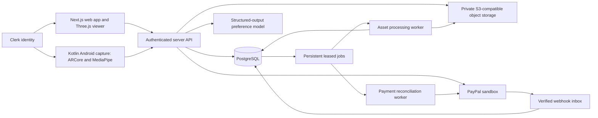

# Architecture, components and contracts

Authority: [PRD.md](PRD.md). This document specifies the proposed implementation, not existing code. Read CAPTURE_AND_3D.md for geometry and PAYMENTS.md for transactional rules. Dependency versions are selected and locked during M0 against current vendor docs; no unverified version is prescribed here.

## A-01: system shape and stack



Default implementation:

- Web/API: TypeScript, React and Next.js App Router, one deployed server application initially. Three.js runs in a browser-only component loaded from a client boundary; do not execute WebGL setup during SSR.
- Persistence: PostgreSQL and Prisma for schema/migrations and transactions. No in-memory inventory/payment store in the acceptance build. Use normal transactions or explicit SQL for locking/leases; verify the selected Prisma version's actual API before coding.
- Identity: one Clerk application for web/native; prebuilt web sign-in and hosted Android Account Portal flow. Email verification codes and configured Google login. [AUTH_REFERENCE.md](AUTH_REFERENCE.md) owns the verified setup details.
- Android: Kotlin with Compose, ARCore, MediaPipe Object Detector and an appropriate mobile model; proposed minSdk26/Java17 baseline, final compatible Gradle/Kotlin/SDK versions verified in M0. Native package proposed `com.roomrelay.app`; register the actual callback with identity provider. No iOS-first scanner.
- Storage: private S3-compatible bucket; configurable provider, local compatible service for development. Signed uploads avoid proxying large media through the web server. Do not invent a paid cloud account; host/bucket selection is a bounded M0 deployment choice.
- Jobs: one background worker and a PostgreSQL jobs table with leases, retries and idempotent handlers. No separate queue service is needed for the first low-volume prototype. CPU normalization/validation initially; GPU reconstruction is an explicitly later, separately deployed worker capability.
- AI: on-device detection plus a server-side structured-output preference/layout adapter. Proposed first text provider is OpenAI Responses via server HTTP or its current SDK. `AI_TEXT_MODEL` is required configuration: select an actually available model supporting the required JSON schema, record it in status, and do not guess a model ID. TwelveLabs is optional video metadata, not a required geometry service.
- Payment: server-side PayPal REST Orders v2 and capture/refund reconciliation, sandbox by default; buyer approval through the current PayPal web checkout integration. Never expose client secret or route an arbitrary merchant supplied by the browser.
- Rendering: first use independent textured GLB items and a dimensioned room. Spark/splats are a P1 enhancement; see the dedicated capture document.

Recommended repository layout when implementation begins:

```text
apps/web/                 Next.js pages, browser viewer, server routes
apps/android/             Kotlin/Compose capture companion
packages/contracts/       shared schemas, enum definitions and fixture contracts
packages/spatial/         tested geometry/normalization/layout validation
workers/assets/           validation, conversion, manifests, lifecycle jobs
workers/reconcile/        payment/retention jobs; may share one worker entry point
prisma/                   schema, migrations and safe seed script
docs/                     authoritative specs and operating evidence
tests/                    integration/E2E fixtures and adversarial cases
```

These are proposed boundaries, not instructions to generate empty packages or abstractions. Start with one web app and necessary tested shared logic; create a package/worker only when its code exists.

## A-02: component responsibilities

| Component | Owns | Must not do |
| --- | --- | --- |
| Seller workspace | Human listing review, price/date/condition | Auto-publish model claims |
| Android capture | Consent, capabilities, frames, poses, labels, guidance | Treat boxes as measured meshes |
| Media intake | Ownership, upload manifests and validation | Accept unbounded arbitrary remote URLs |
| Asset worker | Content inspection, conversion/normalization and lineage | Change order facts or financial state |
| Room editor | Confirmed boundary/obstacles and measurement revisions | Publish private room captures |
| Candidate service | Actual inventory filtering and eligible bundles | Make up unavailable supply |
| Preference adapter | Structured interpretation/proposals | Write prices, seller approvals or payments |
| Spatial validator | Hard fit constraints and recorded assumptions | Replace unknowns with confident prose |
| Viewer | Shared scene transforms and source listing access | Invent accurate hidden surfaces |
| Quote service | Immutable approved item/layout/price/slot snapshot | Carry approval across content changes |
| Checkout service | Atomic holds, server provider requests | Hold DB locks during provider latency |
| Webhook/reconciler | Verified durable provider facts and idempotent transitions | Trust unverified browser success |
| Handoff/support | Pickup, participant acknowledgments, cases | Claim release of app-held escrow |

## A-03: data model

Use UUIDs for internal IDs, UTC timestamps, explicit version integers and JSON schema versions. Money is integer minor units with an ISO currency; geometry is meters. Values from providers stay in provider-specific records plus normalized domain facts. Do not store payment passwords/card data.

| Entity | Required fields and constraints |
| --- | --- |
| User | `id`, unique verified `authSubject`, display name, timestamps, disabled/deletion status; no client-supplied operator flag. |
| SellerProfile | `id`, `userId`, coarse area, private pickup-contact/address reference, `merchantConnectionId`, publish eligibility. |
| MerchantConnection | `id`, environment, server-known merchant ID, mode SINGLE_SELLER/PARTNER, readiness; secret material references only. P0 exactly one enabled sandbox connection. |
| CaptureSession | `id`, owner, kind ROOM/ITEM, consent version, device/runtime metadata, status, source manifest, scene-frame identifier, created/last active time. |
| Asset | owner/session/item/room relationship, PRIVATE/APPROVED_LISTING visibility, type, object key, bytes, content hash, source/derivative IDs, processing status, provenance, normalized transform, schema version, deletion state. |
| Measurement | subject/revision, dimension/boundary field, value/unit, source USER_MEASURED/ARCORE_ESTIMATED/CATALOG_DECLARED, confirmer/time, estimated uncertainty if actually known. Unknown uncertainty stays null. |
| FurnitureItem | seller/merchant, title/category, dimensions/front orientation, condition/included parts, photo IDs, appearance/footprint asset, fixed USD price, pickup window, coarse area, publication state, content version. |
| Inventory | one row per quantity-one item, AVAILABLE/HELD/PAYMENT_PENDING/SOLD, current reservation/order reference, version. One active owner of each item's hold. |
| Room | owner, name, geometry/appearance IDs, canonical boundary, ceiling if known, doors/windows, obstacles/free zones, metric transform, measurement version, draft/confirmed status. |
| Requirements | room/owner, budget cents, currency, categories, hard constraints, style soft preferences, date interval, area filter, version. |
| LayoutRevision | room version, requirements version, parent revision, placements referencing exact item versions, validation findings, total snapshot, author/source, created time; immutable once referenced by quote. |
| ModelRun | owner/task, provider/model/prompt/schema versions, authorized input IDs, latency/usage/status, validated output/reference, no private frame/log dump. |
| Quote | seller/buyer, immutable item/version snapshots, room/layout revision, amount/currency, pickup slot, disclosed terms version, seller/buyer approvals, expiry/status, previous quote reference. |
| Reservation | quote/buyer, ordered item IDs, expiresAt, lifecycle state, checkout reference; atomic all-or-none items. |
| Order | quote/reservation, environment, amount/currency/merchant snapshot, provider order/capture IDs, order/payment/handoff states, request keys, transition version, buyer/seller. |
| PaymentOperation | type CREATE/CAPTURE/REFUND/RECONCILE, order, persistent unique idempotency key, intended amount, submitted/result status, provider ref, redacted error/retry metadata. |
| WebhookInbox | unique `(environment, providerEventId)`, payload hash/minimal redacted provider fields, verification status, processing state/attempts/received time. |
| Refund | capture/order, amount/currency, idempotency key, provider refund ID/status, initiator/reason, completed amount. P0 full refunds only. |
| Pickup/Handoff | order, approved slot, protected location/contact notes, buyer/seller acknowledgments, issues and revision history. |
| SupportCase | order/affected item IDs, participants, status/reason, minimal private evidence, operator audit references. |
| Job | type/subject/version/idempotency key, status, attempts, lease owner/expires, runAfter, input/output references, reason and cancellation token. |
| AuditEvent | actor/service, resource/version, action, correlation ID, timestamp and redacted metadata. Append-only; no raw media or tokens. |

Separate publication state from inventory state. Content updates cannot make SOLD inventory available. Keep purchase facts in order snapshots even if a listing later changes. Financial records must not reference disposable raw capture files as their only evidence.

## A-04: API contracts

All JSON APIs use `/api/v1`, validate with one shared schema source, and return structured errors `{code,message,fieldErrors?,retryable,correlationId}`. IDs/ownership/versions/limits are checked server-side. Mutation requests include `expectedVersion` where data is editable; return 409 on stale writes. Creation/payment retries use durable idempotency keys. Unauthorized reads return 404 for private resources; missing/invalid auth returns 401; permitted users lacking an action role get 403.

| Method / path | Request / purpose | Important rule |
| --- | --- | --- |
| GET `/me/dashboard` | Own drafts, rooms, listings, orders and resumable work | Derived from verified identity, cursor-paginated; no arbitrary user ID. |
| GET `/captures`, `/items`, `/rooms`, `/layouts`, `/quotes`, `/orders` | Own resource lists with cursor/limit | Owner/participant scoping applies before pagination. |
| GET `/captures/:id`, `/items/:id`, `/rooms/:id`, `/layouts/:id`, `/quotes/:id` | Resume an authorized resource and its current revision | Private source media is not included as unbounded embedded data. |
| GET `/assets/:id/download` | Authorized signed derivative/source URL | Owner/participant/operator or explicitly public approved-listing derivative; never expose a private room through an item listing. |
| POST `/captures` | kind, consent version, device/source metadata | Creates private draft owned by session user. |
| POST `/captures/:id/uploads` | allowed type, bytes, hash, asset role | Signed URL/manifest; no remote URL fetch in P0. |
| POST `/captures/:id/finalize` | uploaded asset IDs and metadata hashes | Verify bytes/ownership before queueing. |
| GET `/jobs/:id` | processing stage/result | Owner or operator only; no fabricated ETA. |
| POST `/items`; PATCH `/items/:id` | seller-reviewed fields and version | Editing held/sold purchase facts blocked. |
| POST `/items/:id/publish` | reviewed version | Dimensions/consent/content/merchant status checked. |
| POST `/items/:id/withdraw` | expectedVersion | Available inventory only. |
| GET `/listings` and `/listings/:id` | coarse filters/cursor | Public selected sanitized fields/media only; no room/address. |
| POST/PATCH `/rooms` or `/rooms/:id` | geometry and evidence refs/version | Validate polygon/transforms and invalidate dependent quotes. |
| PUT `/rooms/:id/requirements` | validated budget/categories/date/area | New requirements revision. |
| POST `/rooms/:id/candidates` | room/requirements versions | Eligible actual inventory; up to three validated results. |
| POST `/layouts` | exact placements/item versions | Server reruns spatial validation; client PASS ignored. |
| POST `/layouts/:id/edits` | text or structured edit, parent version | Proposal with schema validation and explicit application. |
| POST `/quotes` | chosen layout/item versions and slot | Creates request; no payment authorization. |
| POST `/quotes/:id/seller-approval` | accepted terms/version | Seller only, immutable replacement on change. |
| POST `/quotes/:id/buyer-approval` | version/acknowledgments | Buyer only; stores approved snapshot. |
| POST `/checkouts` | quote ID + idempotency key | Atomic inventory hold; 409 if not available/stale. |
| POST `/checkouts/:id/paypal-order` | checkout reference only | Server amount/merchant; persistent create request key. |
| POST `/checkouts/:id/capture` | checkout + returned provider order ID | Validate binding/eligibility, stage operation before network. |
| POST `/checkouts/:id/cancel` | request key | Safe release only if no capture can be in flight. |
| GET `/orders/:id` | persistent status/receipt/next action | Participants only; provider secrets excluded. |
| POST `/orders/:id/refund` | reason, expected state, request key | Seller/operator, full actual capture in P0. |
| POST `/orders/:id/pickup-ack` | party acknowledgment/revision | Handoff state only; cannot alter payment. |
| POST `/orders/:id/issues` | affected IDs/reason/private evidence | Participant case with minimal disclosure. |
| POST `/orders/:id/coordination` | Short private order-thread note | Participant only, server timestamps; no external message delivery in P0. |
| PATCH `/orders/:id/pickup` | Proposed slot/private location revision | Participant approval required for changed agreed terms; never changes captured total. |
| POST `/operator/jobs/:id/retry` | Reason and safe retry request | Operator only, audited, version/cost/cancellation checks; cannot forge financial state. |
| POST `/operator/orders/:id/reconcile` | Provider-status retrieval request | Operator only; same authoritative transition rules as the worker. |
| POST `/webhooks/paypal` | provider headers/raw body | Provider authentication, durable inbox and idempotent processing. |
| DELETE `/captures/:id`, `/rooms/:id` | authenticated deletion request | Lineage-aware lifecycle and active order policy. |

Proposed intake limits: photo <=20MB, video <=200MB and <=120 seconds per capture clip, GLB <=50MB upload and <=20MB optimized viewer target, scene total <=30MB transfer target, room polygon <=12 vertices/no holes, <=20 kept/fixed obstacles, <=10 items per prototype layout. These are app defaults, not vendor limits. Reject oversized content before expensive processing; support explicit future configuration changes. POST model/edit text <=2,000 characters; bounded candidate inventory input <=30 items per call. Limits return a field-level action rather than a silent truncated success.

Proposed session caps are <=60 uploaded photos and <=500MB total source uploads; video-derived processing selects <=120 sharp keyframes. Derived decompression/mesh/texture memory has a separate worker limit, not merely the compressed file cap. Default list page is 20, maximum 50, with opaque cursors. Reject excessive sessions/rates using a configured per-user budget; the actual limit and cost evidence are recorded during implementation instead of enabling unlimited anonymous reconstruction.

## A-05: structured AI contract

Send only the authorized task's required dimensions, categories, inventory IDs, constraints and simplified layout; room photos go to an external provider only through a separate consented task. User/listing text is untrusted data, not instructions for service access. The model has no payment or publishing tool.

Expected structured proposal:

```json
{
  "schemaVersion": 1,
  "intent": "PROPOSE_LAYOUT",
  "baseLayoutRevisionId": "layout-reference",
  "placements": [{"itemId":"existing-item","itemVersion":1,"xM":1.0,"zM":1.5,"yawRad":0}],
  "constraintChanges": [],
  "clarification": null,
  "reasonCodes": ["MEETS_REQUIRED_CATEGORY"]
}
```

This is an illustrative shape, not fixture data or an existing provider response. Schema disallows unknown fields and invented IDs. Proposed hard-constraint changes remain unapplied until user approval. Model refusals/timeouts/unparseable output get one bounded retry (or a clarification), then the manual/2D fallback. No endless repair loop. Proposed initial per-call timeout is 20 seconds; record actual latency/cost and adjust explicitly. Numeric validity and geometric fit are independently checked. Reason text shown to users is derived from validated facts, not accepted uncritically from the model.

## A-06: asynchronous processing and data lifecycle

1. Client obtains signed upload for an owned draft; uploads directly to private storage.
2. Finalization confirms hashes/content, creates an idempotent job keyed by asset version and processing stage, and returns quickly.
3. Worker leases one job in a short DB transaction; work executes outside the transaction. Lease heartbeats and cancellation/version checks protect late results.
4. Outputs are private, content-addressed/versioned derivatives. Publish result only if parent version is still current and deletion/cancellation is absent.
5. Retry transient failure with exponential backoff, max three processing attempts by default; terminal error requests human action. Expensive reconstruction is not automatically retried without a configured cost budget.
6. Deletion marks descendants inaccessible immediately, then cleans storage asynchronously. Active order minimal snapshots are protected separately. Retention job uses last activity, listing/order references and user consent rather than deleting a live listing asset blindly.

Asset/model/provider job and payment job are different types with different retry rules. A generic worker retry cannot repeat a financial side effect with a new key.

## A-07: trust, credentials and deployment

Private assets use short-lived signed URLs (proposed 10 minutes download; 15 minutes upload), object keys that do not expose addresses, sanitized approved thumbnails and removed location metadata. Validate file signatures, glTF structure and mesh bounds; disable remote texture/URI fetching and path traversal. Restrict decompression, subprocess time/memory and egress for processing. Never execute an uploaded asset as code.

Use provider-verified identity and resource ownership, same-origin web mutation protection, strict CORS allowlists for web origins and actual native token verification. Do not treat an absent native Origin as authenticated. Operator allowlist is server-side. Access to another user's room, guessed asset ID or order must fail. [Auth details](AUTH_REFERENCE.md).

Configuration inventory (names only):

| Area | Settings |
| --- | --- |
| Database / API | `DATABASE_URL`, `ROOMRELAY_WEB_BASE_URL`, `ROOMRELAY_API_BASE_URL` |
| Identity | `NEXT_PUBLIC_CLERK_PUBLISHABLE_KEY`, `CLERK_SECRET_KEY`, optional `CLERK_JWT_KEY`; Android `CLERK_PUBLISHABLE_KEY` |
| Object store | `OBJECT_STORE_ENDPOINT`, `OBJECT_STORE_REGION`, `OBJECT_STORE_BUCKET`, `OBJECT_STORE_ACCESS_KEY_ID`, `OBJECT_STORE_SECRET_ACCESS_KEY` |
| PayPal | `PAYPAL_ENVIRONMENT` (sandbox), `NEXT_PUBLIC_PAYPAL_CLIENT_ID`, `PAYPAL_CLIENT_SECRET`, `PAYPAL_WEBHOOK_ID`, `PAYPAL_MERCHANT_ID`, `ALLOW_LIVE_PAYMENTS` (false) |
| Text model | `AI_PROVIDER`, `AI_API_KEY`, `AI_TEXT_MODEL`, optional provider endpoint allowlist; no browser/native key |
| Workers | `WORKER_CONCURRENCY`, configured processing cost/size budgets, retention settings and server-only operator IDs |

Validate required settings at startup and capability-specific entry points. A missing credential shows unavailable capability; it does not trigger fake payment/AI success. Public keys are not secrets, but real project identifiers still need no values in docs. `.env.example` contains placeholders when implementation begins, never copied secrets.

Default deployment shape: one Node web/API service, one background worker, managed PostgreSQL and private object storage; Android installed for development on the S24. Render is an optional host for the web/CPU workers, not a claimed GPU reconstruction host. Provider selection/cost/region/access is M0 work; this task has not deployed services. A public HTTPS webhook endpoint/tunnel must be deliberately configured during sandbox implementation. Keep live-mode changes gated by production onboarding, policies and user authorization.

## A-08: observable behavior and recovery

Log resource/correlation IDs, stage durations, byte counts, model usage, state transitions and redacted provider error codes. Never log private frame bodies, passwords/tokens, full address, payment secrets or arbitrary webhook payload dumps. Expose capability and job health without leaking storage credentials. Alert/operator dashboard tracks stuck captures, expired leases, capture-unknown orders, invalid webhook verification and refund reconciliation.

DB transactions enforce inventory/order invariants. Use bounded conflict retries; provider operations are outside locks with durable intent records. There is no distributed atomic transaction between PayPal and PostgreSQL: reconciliation is mandatory. Backups, retention and disaster restore become tested production requirements; no backup guarantees are claimed by this specification.
